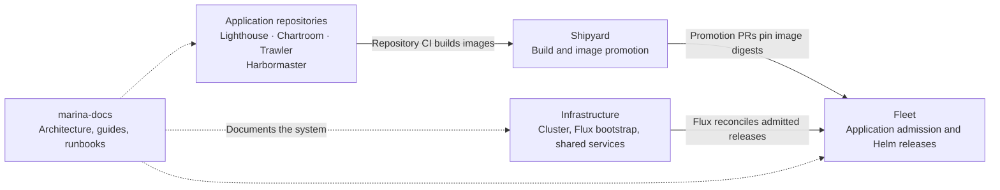
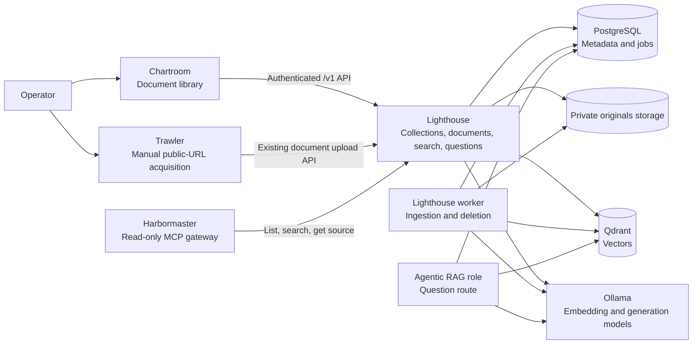
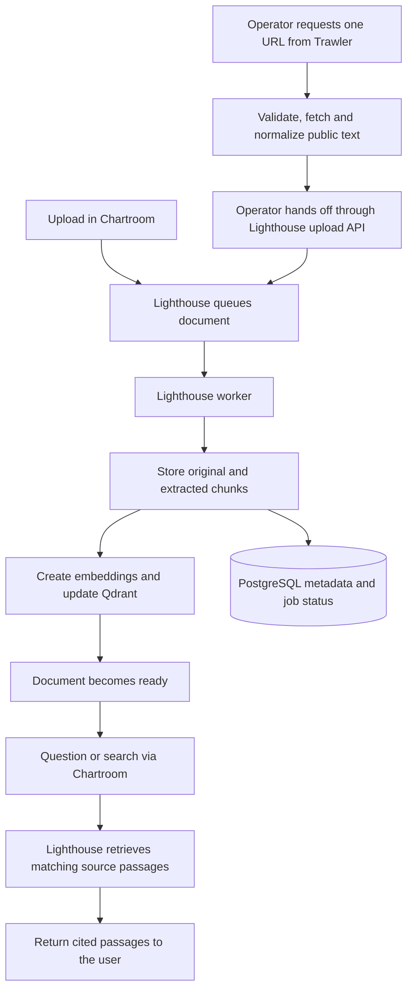
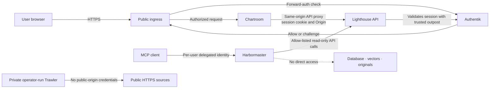
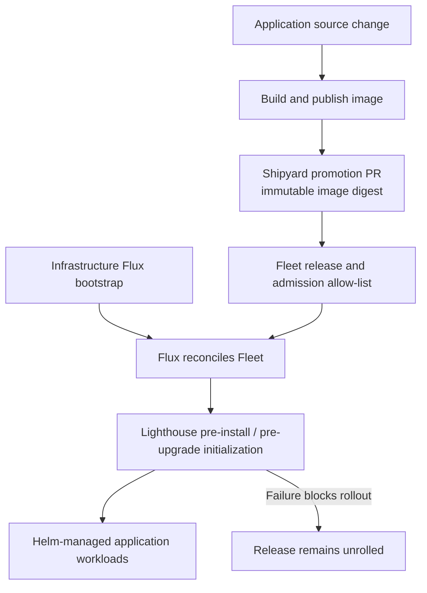
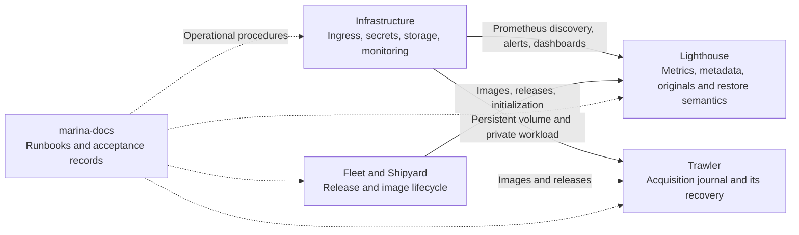

# nnvuf-homelab

This homelab runs **MARINA**, a private document library and retrieval system.
Its services collect documents under operator control, index them, and return
source passages through a browser UI or read-only MCP tools. The
[marina-docs repository](https://github.com/nnvuf-homelab/marina-docs) is the
canonical guide; check its operations runbooks for current deployment status.

## How the repositories fit together

Application code, cluster configuration, deployment admission, and documentation
have separate homes:

Infrastructure owns cluster services and runtime configuration. Fleet defines
which applications Flux may deploy; Shipyard promotes application images.
Application repositories own source code, while `marina-docs` owns the
cross-project documentation. See [Fleet's ownership and release guide](https://github.com/nnvuf-homelab/marina-docs/blob/main/fleet/README.md).

## MARINA at a glance

Chartroom manages collections, uploads, indexing status, and source-backed
questions. Lighthouse is the API and indexing backend. Trawler is an optional,
operator-controlled acquisition path; it does not crawl in the background.
Harbormaster provides a read-only MCP interface. Lighthouse also defines an
`agentic-rag` role; the `knowledge-learning` role is a scaffold, not an active
learning service. See the [product guides](https://github.com/nnvuf-homelab/marina-docs#products).

### Document and answer flows

Only ready documents participate in answers. Answers are source-first: inspect
the cited passages and their context rather than treating a quotation as a
guarantee of truth or completeness. Trawler preserves provenance and reuses
Lighthouse's existing upload/indexing path; see the [Trawler guide](https://github.com/nnvuf-homelab/marina-docs/blob/main/trawler/README.md).

## Access boundaries

The browser session is Authentik-managed; Lighthouse independently validates
it rather than trusting identity headers. Harbormaster is limited to listing
collections, searching, and retrieving exact source chunks. Trawler's service
should remain private; only the one-shot handoff uses an operator's Lighthouse
session. See the [Chartroom guide](https://github.com/nnvuf-homelab/marina-docs/blob/main/chartroom/README.md),
[Harbormaster guide](https://github.com/nnvuf-homelab/marina-docs/blob/main/harbormaster/README.md),
and [MCP OAuth runbook](https://github.com/nnvuf-homelab/marina-docs/blob/main/Infrastructure/docs/runbooks/marina-mcp-oauth.md).

## Cluster lifecycle and operations

Runtime credentials, ingress, persistent storage, and monitoring are provisioned
by Infrastructure and consumed through Fleet releases. Backups and recovery are
service-specific; a Lighthouse archive does not include Trawler's acquisition
journal. Production release gates and operational acceptance can change, so
consult [MARINA operations](https://github.com/nnvuf-homelab/marina-docs/blob/main/Infrastructure/docs/runbooks/marina-operations.md)
and the [Lighthouse production runbook](https://github.com/nnvuf-homelab/marina-docs/blob/main/lighthouse/PRODUCTION-RUNBOOK.md)
before making operational decisions.

## Further reading

- [Canonical documentation index](https://github.com/nnvuf-homelab/marina-docs)
- [Infrastructure and operations](https://github.com/nnvuf-homelab/marina-docs/tree/main/Infrastructure/docs)
- [Lighthouse architecture and development](https://github.com/nnvuf-homelab/marina-docs/blob/main/lighthouse/README.md)
- [Fleet deployment ownership](https://github.com/nnvuf-homelab/marina-docs/blob/main/fleet/README.md)
